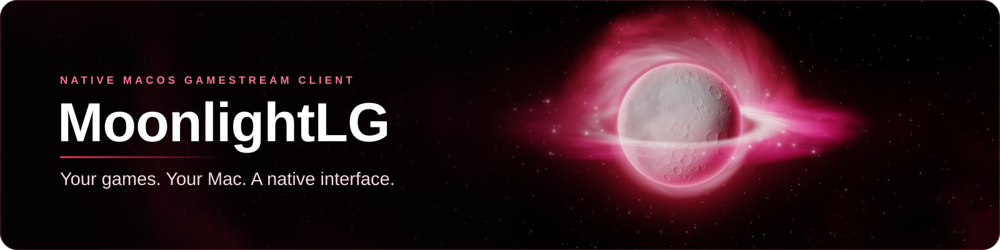

<div align="center">



# 🌙 MoonlightLG

### Your games. Your Mac. A native interface.

**1.3.2.0 · Crimson Glass · Apple Silicon + Intel · Moonlight Qt 6.2.0**

[](https://github.com/th3d3ck3r/moonlight-native-glass/releases/tag/moonlightlg-v1.3.2.0)


[](https://github.com/th3d3ck3r/moonlight-native-glass/blob/moonlightlg-v1.3.2.0/LICENSE)

A native macOS client for Sunshine and compatible GameStream hosts, including VibePollo.
A near-black **Crimson Glass** interface, deep-red accents, native navigation, and the Moonlight streaming engine underneath.

[📦 Download](#-download) · [✨ Features](#-features) · [🖼️ Screenshots](#-screenshots) · [🚀 Install](#-install-and-connect) · [🎛️ Controls](#-stream-controls) · [🛠️ Build](#-build-from-source)

</div>

Release preparation: **1.3.5.4 · Touch Bar and animations** is unpublished and on hold for owner approval. The public stable downloads below remain 1.3.2.0.

Private development: **1.3.6.0U · build 55** adds auto-scaling three-minute graphs inside the existing Touch Bar statistics cards. Layout, buttons, protected moon area and Audio/Back navigation are unchanged. Physical M1 acceptance remains required.

## 📦 Download

### 🌙 MoonlightLG 1.3.2.0

| Your Mac | Package |
|---|---|
| 🍎 **Apple Silicon — M1 and newer** | [**Download Apple Silicon-only ZIP**](https://github.com/th3d3ck3r/moonlight-native-glass/releases/download/moonlightlg-v1.3.2.0/MoonlightLG-1.3.2.0-arm64.zip) |
| 🖥️ **Intel** | [Download Intel ZIP](https://github.com/th3d3ck3r/moonlight-native-glass/releases/download/moonlightlg-v1.3.2.0/MoonlightLG-1.3.2.0-x86_64.zip) |
| 💻 **Both architectures** | [Download Universal ZIP](https://github.com/th3d3ck3r/moonlight-native-glass/releases/download/moonlightlg-v1.3.2.0/MoonlightLG-1.3.2.0-universal.zip) |

[📝 Release notes](https://github.com/th3d3ck3r/moonlight-native-glass/releases/tag/moonlightlg-v1.3.2.0) · [🔐 SHA-256 checksums](https://github.com/th3d3ck3r/moonlight-native-glass/releases/download/moonlightlg-v1.3.2.0/SHA256SUMS.txt) · [📚 Changelog](https://github.com/th3d3ck3r/moonlight-native-glass/blob/moonlightlg-v1.3.2.0/CHANGELOG.md) · [Earlier releases](https://github.com/th3d3ck3r/moonlight-native-glass/releases)

**Requires macOS 15 or later.** Apple Silicon-only includes arm64 code throughout the app, bundled engine, frameworks, and plugins. Universal includes Apple Silicon and Intel support.

## ✨ Features

| | What you get |
|---|---|
| 🫧 **Native macOS interface** | Sidebar, toolbar, game cards, pairing sheets, and native Settings. Liquid Glass on macOS 26+, with standard native styling on macOS 15. |
| 🌑 **Crimson Glass** | Near-black surfaces, crimson accents, matching moon artwork, and rounded controls. Turn it off in Appearance to follow your system appearance. |
| 🛰️ **Apollo connection screen** | Watch the spacecraft reach the moon, follow real connection status, and choose **Continue to Stream** when ready. |
| 🎮 **Game library** | Host discovery, manual addresses, pairing, artwork, search, launch, wake, rename, hide/show games, and host-game quit actions. |
| 🎛️ **Stream controls** | Native title controls, input capture/release, fullscreen controls, playback volume/mute, and menu bar access. |
| 📊 **Stream statistics** | Crimson Glass cards, original stream readings, and optional rolling sparklines. A persistent Graphs toggle switches to compact values. |
| 🖥️ **Local hardware monitor** | CPU, memory, network, thermal status, and GPU data where available. Adjust its position, size, opacity, metrics, and refresh cadence. |
| 🎬 **Recording & replay** | Optional recording/replay plugin with Original Stream Quality and hardware-encoding options. Enable it in Recording settings before a stream. |
| 🔊 **Independent playback audio** | Local volume and mute controls preserve the recorder's source audio. |
| 🌙 **Menu bar companion** | Reopen the library, restore an existing stream, open Settings, or quit. |
| 📦 **Manual updates** | Install a newer package when you choose. |

## 🖼️ Screenshots

| 🌑 Crimson Glass library | 🎛️ Stream controls |
|---|---|
|  |  |

<details>
<summary>🚀 Startup, Settings, and About</summary>


</details>

*Captured from the app with sample hosts. These images show the interface; they are not streaming benchmarks.*

## 🚀 Install and connect

1. Download the package for your Mac and extract the ZIP.
2. Quit any running copy, then move **MoonlightLG.app** into **Applications**, replacing the previous copy if you are updating.
3. Open MoonlightLG. Packages are ad-hoc signed and verified, but not Developer ID signed or notarized. If macOS blocks opening, use **System Settings → Privacy & Security → Open Anyway**.
4. Allow **Local Network** access. Discover your host or add its address, then pair it in MoonlightLG.
5. Choose a game or Desktop. When the Apollo screen says Connected, click **Continue to Stream**.

Updating MoonlightLG preserves its existing preference and pairing identities. Pairing is separate from stock Moonlight and Enhanced clients.

<details>
<summary>🔐 Verify a download</summary>

Download `SHA256SUMS.txt` alongside the ZIP. For the Apple Silicon package, open that folder in Terminal and run:

```bash
shasum -a 256 MoonlightLG-1.3.2.0-arm64.zip
```

Compare the result with the matching filename in `SHA256SUMS.txt`.

</details>

## 🎛️ Stream controls

| Default shortcut | Action |
|---|---|
| **Control–Option–Shift–Q** | Hide the stream window while keeping the session connected |
| **Control–Option–Shift–O** | Show or hide stream controls |
| **Control–Option–Shift–B** | Disconnect without quitting the host game |
| **Start + Select + L1 + R1** | Controller disconnect shortcut |

Closing a windowed stream hides it. Click the menu bar moon to bring it back. Shortcuts can be customized in Settings. **Disconnect and Exit** also quits the host game.

## 🆕 In 1.3.2.0

- 🍎 A dedicated Apple Silicon-only package, including arm64-only dependencies.
- 🛰️ Continue controls that keep the Qt/SDL event loop responsive during a mouse press.
- ⏱️ Shared handoff timeout and visible recovery if the stream window fails to open.
- ✅ Stream state follows the window confirmation instead of treating a Continue acknowledgement as a running stream.
- 📊 Crimson Glass stream statistics and optional graphs, local hardware monitoring, and independent playback volume.

## 🧪 Validation and compatibility

Release packages are published after complete architecture/bundle checks, native macOS and Xcode validation, UI tests, connection-button/recovery tests, window/fullscreen/Metal probes, and sanitizer checks. Apple Silicon-only packages additionally require every bundled Mach-O file to contain exactly the arm64 slice.

The bundled engine is **Moonlight Qt 6.2.0**. Codec, HDR, hardware decoding, controller, and recording support depend on your Mac and host. CI does not measure live-host latency or establish streaming correctness on every physical Mac. Physical-host, HDR, surround-audio, and performance acceptance remain limited.

For a problem report, include your Mac model, macOS version, host software, window mode, and what happened. **Open Engine Logs** is available from the app menu. [🐛 Report an issue](https://github.com/th3d3ck3r/moonlight-native-glass/issues).

## 🛠️ Build from source

Use Xcode 26+, Qt 6.11.2, and Python 3:

```bash
git clone --recurse-submodules --branch moonlightlg-v1.3.2.0 https://github.com/th3d3ck3r/moonlight-native-glass.git
cd moonlight-native-glass
bash scripts/build-native-macos.sh arm64
# Intel:     bash scripts/build-native-macos.sh x86_64
# Universal: bash scripts/build-native-macos.sh universal
```

Open **MoonlightLG.xcodeproj** for the main app, Startup Preview, and UI Preview schemes. The release tag is the source for these downloads; `feature/recording-plugin` contains ongoing development. `master` retains the upstream engine baseline and project overview.

## 💛 Credits & license

**About MoonlightLG → Licenses & Notices** opens the bundled offline copyright and license texts. **Corresponding Source** opens the complete release source package, including application submodules and pinned dependency source archives.

[📦 Corresponding source](https://github.com/th3d3ck3r/moonlight-native-glass/releases/download/moonlightlg-v1.3.2.0/MoonlightLG-1.3.2.0-source.tar.gz) · [📜 Third-party notices](https://github.com/th3d3ck3r/moonlight-native-glass/releases/download/moonlightlg-v1.3.2.0/THIRD_PARTY_NOTICES.txt)

Built on [Moonlight Qt](https://github.com/moonlight-stream/moonlight-qt) and [moonlight-common-c](https://github.com/moonlight-stream/moonlight-common-c), with a native SwiftUI/AppKit frontend. Original copyright and license attribution are retained.

[GPL-3.0 license](https://github.com/th3d3ck3r/moonlight-native-glass/blob/moonlightlg-v1.3.2.0/LICENSE)

This software is based in part on the work of the FreeType Team.
This software is based in part on the work of the Independent JPEG Group.
